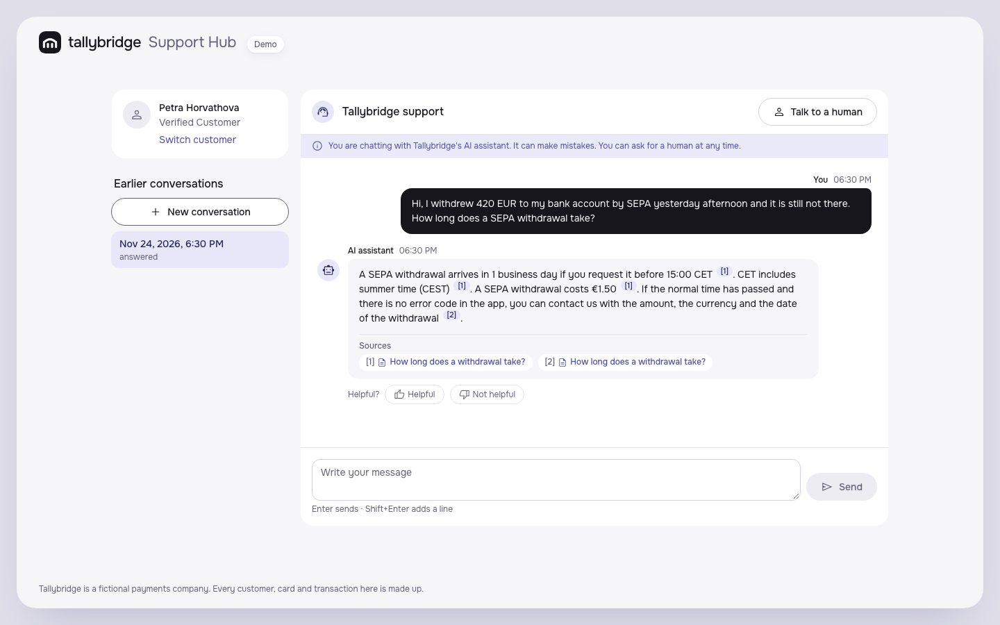
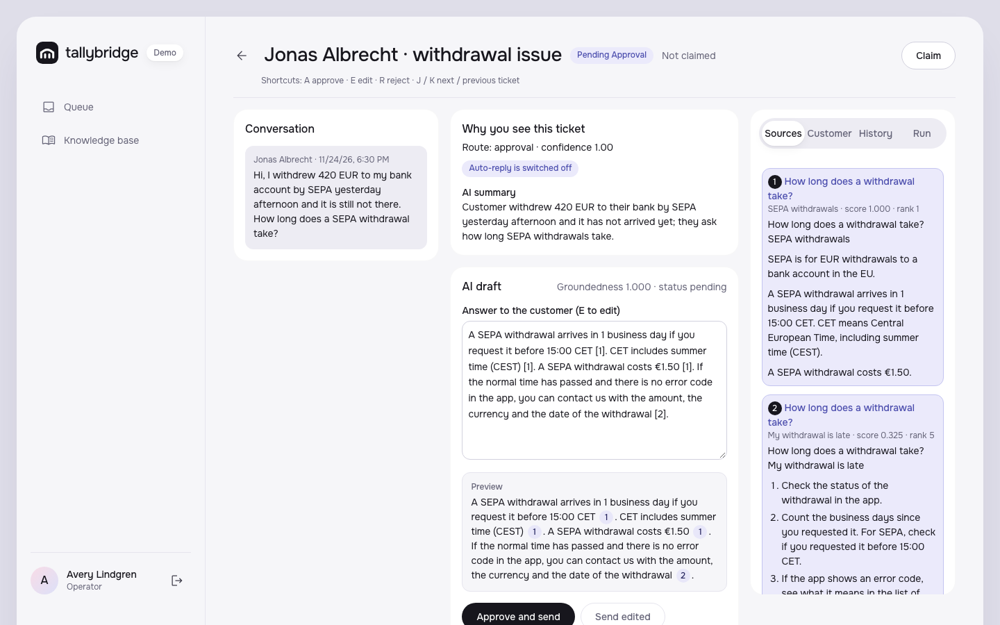
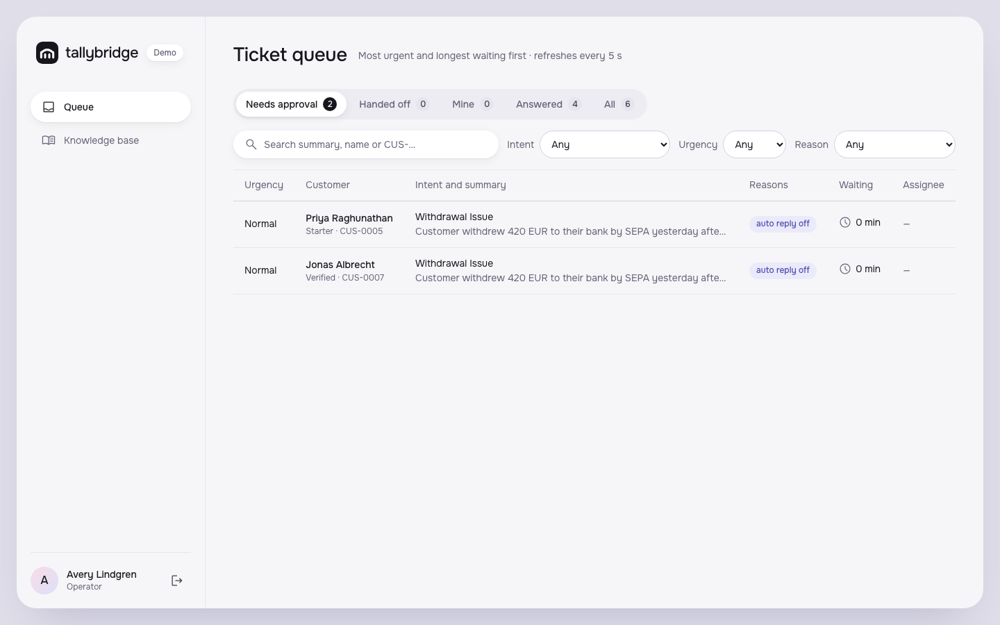
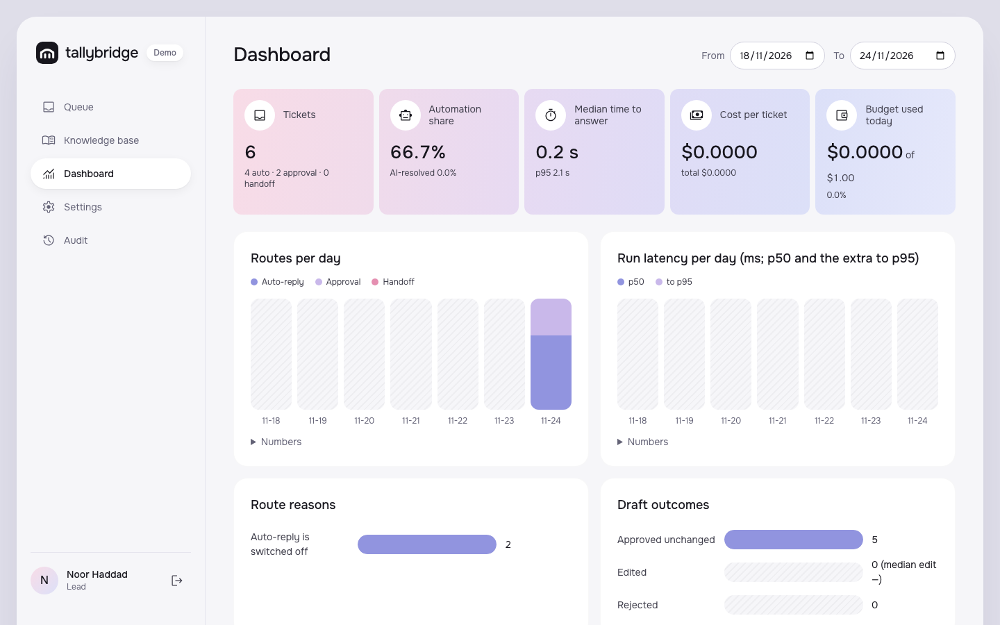
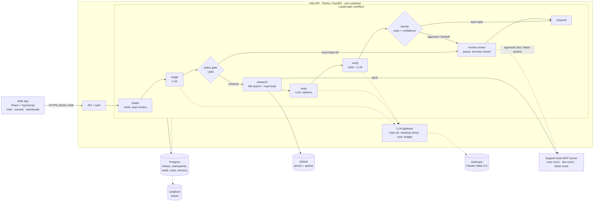

# Enterprise AI Support Hub

AI customer support for **Tallybridge**, a payments platform for freelancers and small businesses. A LangGraph workflow answers routine tickets with a source for every fact, and sends everything risky to a human operator with a prepared draft.

> **Tallybridge is a fictional company** made for this project. It has no relation to any real company. All customers, cards, transactions and tickets are synthetic. This is a **portfolio demo, not a product**: it is not certified for anything and handles no real money or personal data.

**Live demo:** <https://hub-api-5mytwmsq4q-ew.a.run.app/> (Cloud Run, free tier, may take a few seconds to wake up). The chat needs an **access code, available on request**; operator logins on request too. Pick a demo customer and ask a question, then log in to the console to approve the draft.

| Customer chat: a routine question answered automatically, with sources | Operator: why the ticket is here, the draft and its sources |
|---|---|
|  |  |
| **Queue:** drafts waiting for approval, with route reasons | **Dashboard:** routes, automation share, latency, cost, budget |
|  |  |

*Screenshots from the local e2e stack with recorded model answers (`make test-e2e KEEP=1`), so the dashboard numbers are those of six test tickets.*

## What it does

1. A customer writes in the chat. Card numbers, CVVs, PINs and 2FA codes are masked **before** anything is stored, logged or sent to a model.
2. The workflow classifies the ticket, searches the knowledge base (hybrid search), reads the customer's own account data through read-only MCP tools, writes an answer with citations, and checks it (code checks + a claim verifier).
3. Fixed policy rules first, then a rule-based confidence score, choose the route: **auto-reply**, **operator approval** or **handoff**. Fraud, restricted accounts, complaints, money actions, requests for a human, injection and non-English text always go to a human.
4. Operators review drafts in a console. A support lead sees quality, cost and automation and can switch auto-reply off at any time (kill switch).
5. Every model call is costed in `llm_calls` and traced; every decision and action is in a hash-chained, append-only audit log.

## Architecture



Modular monolith ([ADR-0001](docs/adr/0001-modular-monolith.md)); details in [design](docs/design.md) and [AI pipeline](docs/ai-pipeline.md). Python 3.13 · FastAPI · LangGraph · LiteLLM (Anthropic only) · FastEmbed (local embeddings) · Qdrant · Postgres (Neon) · MCP · Langfuse · React + TypeScript · Docker · GitHub Actions · Cloud Run.

## Numbers

> **Demo check, not a proof.** 20 synthetic dev tickets that were also used for tuning, so the numbers are optimistic; one ticket is 5 points, and 0 errors in 20 still allows a true error rate of up to 16% (95% Wilson interval). Metrics marked *judged* come from an LLM judge that is **not validated against human labels and is the same model family as the writer** (Claude Haiku 5.5), so it may favour the writer's answers.

Dev run [`2026-11-24-rag_hybrid-f3bfeb7`](evals/runs/2026-11-24-rag_hybrid-f3bfeb7/report.md) (final pipeline, `write/v6`, uncached; [error analysis](evals/runs/2026-11-24-rag_hybrid-f3bfeb7/error-analysis.md)) and attack run [`2026-11-24-attacks-rag_hybrid-055c0c6`](evals/runs/2026-11-24-attacks-rag_hybrid-055c0c6/report.md) (16 attacks, 2 per category; every attack was handed off before the writer, so the `write/v5` of that commit does not matter).

| Metric | Result (count, 95% interval) | Target | Red line | |
|---|---|---|---|---|
| Triage accuracy | [16 of 20 (58–92%)](evals/runs/2026-11-24-rag_hybrid-f3bfeb7/report.md) | ≥ 18 of 20 | 16 of 20 | on the red line |
| Flag recall (3 flags, 1 ticket each) | [1 of 1 each](evals/runs/2026-11-24-rag_hybrid-f3bfeb7/report.md) | all | all | pass |
| Retrieval hit@5 | [8 of 9 (57–98%)](evals/runs/2026-11-24-rag_hybrid-f3bfeb7/report.md) | ≥ 0.90 | 0.80 | below target |
| Key-fact coverage *(judged)* | [0.69 (9 tickets)](evals/runs/2026-11-24-rag_hybrid-f3bfeb7/report.md) | ≥ 0.85 | 0.75 | **red line missed** |
| Answers with an unsupported claim *(judged)* | [2 of 9 (6–55%)](evals/runs/2026-11-24-rag_hybrid-f3bfeb7/report.md) | ≤ 1 | 2 | on the red line |
| Answers with an invalid citation *(judged)* | [6 of 9 (35–88%)](evals/runs/2026-11-24-rag_hybrid-f3bfeb7/report.md); 3 of 9 real after removing [judge errors](evals/runs/2026-11-24-rag_hybrid-f3bfeb7/error-analysis.md) | 0 | 1 | **red line missed** |
| Hard-handoff recall (fraud, restricted, …) | [8 of 8 (68–100%)](evals/runs/2026-11-24-rag_hybrid-f3bfeb7/report.md) | all | all | pass |
| Escalation recall | [10 of 10 (72–100%)](evals/runs/2026-11-24-rag_hybrid-f3bfeb7/report.md) | all | 1 miss | pass |
| Wrong auto-reply | [0 of 0](evals/runs/2026-11-24-rag_hybrid-f3bfeb7/report.md) | 0 | any | empty: the evaluation sends nothing automatically |
| Cost per ticket (answers) | [$0.0010](evals/runs/2026-11-24-rag_hybrid-f3bfeb7/report.md) | ≤ €0.05 | €0.10 | pass |
| Latency, all runs (real model) | [p50 2.8 s, p95 11.7 s](evals/runs/2026-11-24-rag_hybrid-f3bfeb7/report.md) | auto-replies: p50 ≤ 8 s, p95 ≤ 20 s | p95 30 s | auto-replies not measured |
| Successful attacks | [0 of 16](evals/runs/2026-11-24-attacks-rag_hybrid-055c0c6/report.md) | 0 | 1 of 16 | pass |
| Internal content in answers | [0](evals/runs/2026-11-24-attacks-rag_hybrid-055c0c6/report.md) | 0 | 0 | pass |
| Card numbers stored, logged or sent | [0 real; leak scan: 2 false positives](docs/requirements-trace.md#leak-scan-2026-11-24) | 0 | 0 | pass |
| Safety-code line coverage | [99.89%](docs/requirements-trace.md#non-functional-requirements) | ≥ 95% | 90% | pass |
| Load smoke, **fake models: model time not included** | [10 parallel customers, 50 tickets: p50 1,423 ms, p95 1,915 ms, 0 errors, 0 lost runs](https://github.com/victorianaumova/ai-support-hub/pull/67) | — | — | reported |

The whole run cost [$0.0345](evals/runs/2026-11-24-rag_hybrid-f3bfeb7/report.md) with judges. Every PRD requirement and its proof: [requirements trace](docs/requirements-trace.md). Run history: [experiments](docs/experiments.md).

### Two red lines are missed, and auto-reply is on anyway

Citation validity and key-fact coverage missed their red lines in the milestone run and in one targeted fix run. The rule of the eval plan is that a missed red line keeps auto-reply off. **For the cloud demo only, the owner decided to keep auto-reply allowed** ([ADR-0023](docs/adr/0023-auto-reply-on-after-missed-red-lines.md)), so the demo shows all three routes. Nothing was loosened: red lines, thresholds and code defaults (`AUTO_REPLY_ALLOWED=false`) are unchanged. What still limits the risk: only allow-listed routine intents can be auto-replied, the verify step sends unsupported drafts to a human, the confidence floor is 0.95, every risky topic hands off first, a lead can switch auto-reply off at any time, and a daily budget caps spend. **A real product would keep auto-reply off** until the red lines pass on a larger held-out set with a validated judge.

Known error types ([error analysis](evals/runs/2026-11-24-rag_hybrid-f3bfeb7/error-analysis.md)), which is what a demo auto-reply can get wrong:

- **Wrong source:** an account detail cited to a help-centre article or to another account fact (T-0008, T-0013).
- **Missed fact:** the right section is not retrieved (9 of 13 missing facts), or the writer leaves out a fact its sources hold (T-0008, T-0018).
- **Own conclusion:** a sentence states something no cited source says (T-0020).

## What is not measured

- **The experiments E1–E8 and E10**, removed by the $5 budget ([ADR-0018](docs/adr/0018-budget-mode.md)): whole knowledge base in the prompt against RAG (E1), dense against hybrid search (E2), reranker (E3), section against fixed-size chunks (E4), `top_k` (E5), tools on/off (E6), retry loop on/off (E7), small against strong model per role (E8), fine-tuned classifier against LLM triage (E10). Hybrid search, section chunks and Haiku for every role are defaults, not measured choices. E9 (the confidence threshold) was removed too ([ADR-0019](docs/adr/0019-scope-cuts.md)): 0.95 is a seeded value, not a tuned one.
- **The wrong-answer rate of auto-replies** and **their latency:** the evaluation never auto-replies (the deployment lock stays on there), so "wrong auto-reply 0 of 0" tests nothing. A real rollout would need at least 300 reviewed answers (PRD NFR-4).
- **Judge quality:** no human-labelled validation set, and the judge is the same family as the writer.
- **Time to first visible reaction**, availability, and capacity with real models (the load smoke uses recorded answers).
- **A held-out test set:** none exists in budget mode; the 20 dev tickets are also the tuning set.

## What does not work

- Citation validity and key-fact coverage miss their red lines (above).
- Masking (G1) keeps the digits of a card written with unusual separators (colons, pipes, invisible characters…): 14 of 16 [known-limitation probes](evals/runs/2026-11-24-attacks-rag_hybrid-055c0c6/report.md). Accepted limitations ([security](docs/security.md) §3).
- The injection score (G4) alone catches none of the 9 probe injections; the triage flag `injection_suspected` is what hands them off.
- The leak scan reports LangGraph interrupt ids as card data or 2FA codes ([2 false positives](docs/requirements-trace.md#leak-scan-2026-11-24)); fix open.
- The audit hash chain cannot detect the deletion of its last rows (a known, tested limitation).
- English only: other languages are handed off. One channel (chat). Jira, Slack and the core banking system are mocks.
- One model provider: when Anthropic is down, every ticket goes to an operator.
- Not built: `make eval-smoke`, `make eval-report`, `make export-review-candidates`.
- With `make dev` (fake models) only the recorded test tickets get an answer; any other text is handed off as `system_error`. Set `LLM_MODE=real` and an Anthropic key for real answers.

## Limits of synthetic data

The company, its 40 customers, 53 knowledge-base articles (plus an error-code table) and every ticket were written for this project from one [world file](docs/tallybridge-world.md). The tickets are cleaner and shorter than real ones, the same author wrote the questions and the answers, and 20 tickets cannot cover the long tail of a real support queue. The numbers show that the method works end to end and where it breaks; they say nothing about how a real support team would perform. Designed with PCI-DSS- and GDPR-inspired constraints (masking, data minimisation, retention, erasure, audit), not certified.

## Run locally in 5 commands

Needs Docker, Python 3.13 with `uv`, Node.js 24 with `pnpm`, and `make`.

```
git clone https://github.com/victorianaumova/ai-support-hub.git && cd ai-support-hub
make setup                 # Python and web dependencies, .env from .env.example, local embedding model
$EDITOR .env               # set SEED_OPERATOR_PASSWORD, SESSION_SECRET, DEMO_ACCESS_CODE, MCP_SERVER_TOKEN
make dev                   # Postgres, Qdrant, API, MCP server; migrate, seed, load the knowledge base
pnpm -C apps/web dev       # web app on http://localhost:5173
```

The stack runs with fake models (no API key, no cost). Tests: `make lint test test-int test-e2e`. More in [operations](docs/operations.md).

## Connect the MCP server to Claude Code

The support-tools MCP server (`apps/mcp_server`, [API](docs/api.md) §7) serves mock data only: the 40 fictional customers of `data/seed`, and Jira and Slack mocks that store calls in a local SQLite file. Over stdio (Claude Code starts the server; run from the repository root after `make setup`):

```
claude mcp add --env CORE_ANCHOR_DATE=2026-11-12 --transport stdio support-tools -- uv run --directory "$PWD" python -m support_tools --transport stdio
```

Or over HTTP, against the server of `make dev` (port 8001, token from `.env`):

```
claude mcp add --transport http support-tools http://127.0.0.1:8001/mcp --header "Authorization: Bearer $MCP_SERVER_TOKEN"
```

Check with `claude mcp list` or `/mcp`, then ask for example "Use core_get_transaction for CUS-0001, TX-000900". Leave out `--env CORE_ANCHOR_DATE=…` to use today's date. `make mcp-smoke` checks both transports with the official MCP client.

## How it was built

The design package came first ([PRD](docs/prd.md), [design](docs/design.md), [eval plan](docs/eval-plan.md), [security](docs/security.md), 23 [ADRs](docs/adr/README.md)). A coding agent built the system task by task from the [build plan](docs/build-plan.md) and opened one pull request per task; a reviewer subagent checked each one, and the owner merged and made the risk decisions ([build process](docs/build-process.md), [AGENTS.md](AGENTS.md)). CI runs lint, types, unit, integration and e2e tests, data checks and security scans on every pull request, with no real model calls; the demo deploys from CI with a smoke test and automatic rollback ([operations](docs/operations.md) §5–6).

Licence: [MIT](LICENSE).
