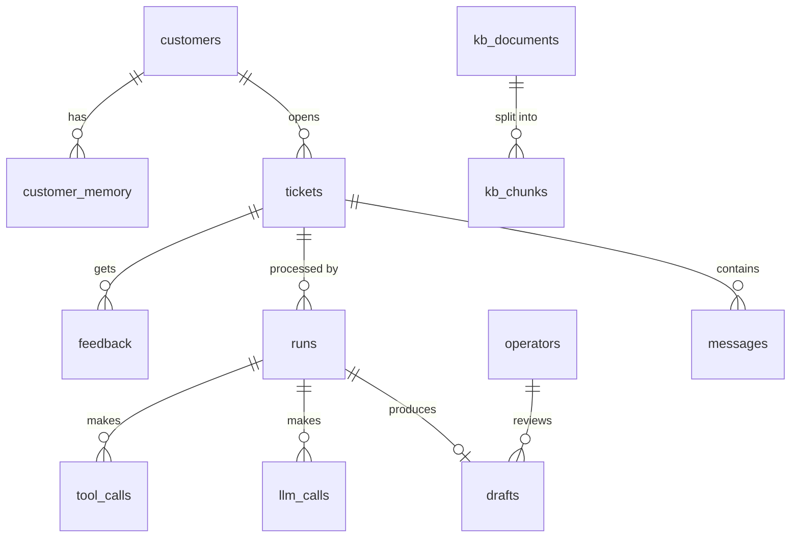
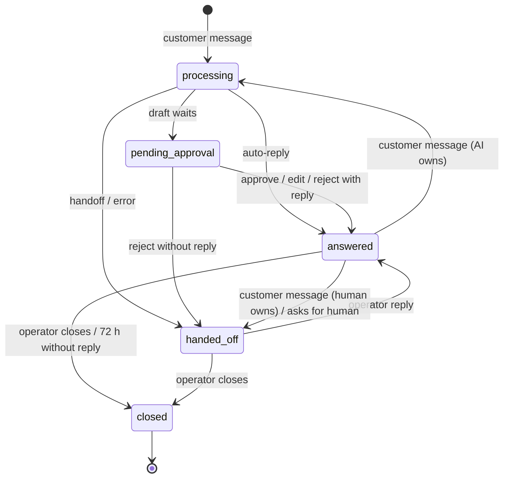

# Data Model

Three kinds of data: the Postgres database (system of record), the Qdrant collection (search index, can always be rebuilt), and files in `data/` (knowledge base, seed data, evaluation sets).

## 1. Postgres

Conventions: `snake_case`; primary keys are UUID v7 (`id`) unless noted (generated in the application; the Python 3.13 standard library has no `uuid7`, so the builder picks a small library or the database function if the Postgres version has one); all timestamps are `timestamptz` in UTC; enums are stored as text with a `CHECK` constraint; every table has `created_at`. Migrations: Alembic, one migration per change, never edit an applied migration.



### customers
Mirror of the demo customers from the core mock. Only what the Hub needs.

| Column | Type | Note |
|---|---|---|
| id | uuid PK | |
| external_ref | text unique | id in the core system, e.g. `CUS-0007` |
| display_name | text | |
| email | text | |
| tier | text | `starter` \| `verified` \| `business` |
| country | text | ISO 3166-1 alpha-2 |
| anonymised_at | timestamptz null | set by erasure |

### operators

| Column | Type | Note |
|---|---|---|
| id | uuid PK | |
| email | text unique | |
| name | text | |
| password_hash | text | Argon2id |
| role | text | `operator` \| `lead` \| `compliance` \| `admin` |
| is_active | bool | |
| last_login_at | timestamptz null | |
| failed_logins | int | wrong passwords since the last success or lock; `CHECK >= 0` (security §4) |
| locked_until | timestamptz null | login refused until then (10th wrong password → 15 minutes) |
| session_version | int | starts at 1, `CHECK >= 1`; written into the signed session cookie. Logout and a password change increase it, which ends every session of the operator |

### tickets

| Column | Type | Note |
|---|---|---|
| id | uuid PK | also the LangGraph `thread_id` |
| customer_id | uuid FK | |
| channel | text | `chat` |
| status | text | `processing` \| `pending_approval` \| `handed_off` \| `answered` \| `closed` |
| intent | text null | one of the 12 intents |
| secondary_intent | text null | |
| urgency | text null | `low` \| `normal` \| `high` |
| language | text null | ISO 639-1 |
| summary | text null | written by triage, replaced by the operator summary of `handoff_summary` on a handoff (P6-02); placeholders restored, then card data masked (G1); for operators only, never sent to the customer |
| last_route | text null | `auto_reply` \| `approval` \| `handoff` |
| route_reasons | jsonb | list of reason codes, see [ai-pipeline](ai-pipeline.md) §6 |
| confidence | numeric(4,3) null | |
| assigned_operator_id | uuid FK null | |
| ai_disclosed_at | timestamptz | when the AI notice was shown |
| first_response_at, resolved_at | timestamptz null | |
| resolution | text null | `ai` \| `ai_approved` \| `ai_edited` \| `human` |
| version | int | optimistic lock, incremented on every change and on every customer message (also when the status stays the same, P6-03), so an operator's decision loaded before the message is stale |

Indexes: `(status, urgency, created_at)`, `(customer_id, created_at)`, `(assigned_operator_id, status)`.

Status transitions (anything else is an error):



Ownership rule: after the first handoff or approval in a ticket, a human owns the ticket. New customer messages do not start a new AI run; they appear in the operator queue.

`processing → answered` is the AI's auto-reply only; an operator never takes it. From P3-05 a new ticket gets a run of the workflow (the LangGraph graph from P6-01), which ends in `pending_approval`, `handed_off` or (auto-reply, P6-02, only when turned on) `answered`; while it runs, or if no run started, it reaches the operators through the queue, and a claim hands it off first (`processing → handed_off`, reason `operator_takeover`, [ai-pipeline](ai-pipeline.md) §6). Then the operator replies (`handed_off → answered`).

The status changes only through `TicketRepository.change_status`, which checks this diagram. A status set any other way is refused when the session flushes, and every `INSERT`, `UPDATE` or `DELETE` statement on `tickets` run with `Session.execute` (a bulk statement, which the flush checks never see) is refused too. Many tickets, such as the `close-stale` job, are changed one by one.

Closing: an operator closes a ticket by hand, or the scheduled job `close-stale` closes `answered` tickets after 72 h without a customer message. Closing writes the memory summary ([ai-pipeline](ai-pipeline.md) §9).

### messages

| Column | Type | Note |
|---|---|---|
| id | uuid PK | |
| ticket_id | uuid FK | |
| role | text | `customer` \| `assistant` \| `operator` \| `system` |
| body | text | card data already masked; never the raw text |
| is_ai_generated | bool | drives the label in the UI |
| author_operator_id | uuid FK null | the operator who wrote the message; on an `assistant` message the operator who approved the AI draft unchanged (label "AI assistant · reviewed by <name>", P3-05b) |
| run_id | uuid FK null | `ON DELETE SET NULL` (P3-05) |
| citations | jsonb | `[{"marker": 1, "chunk_id": "...", "doc_id": "...", "title": "...", "url": "..."}]` |
| masked_entities | jsonb | counts by type only, e.g. `{"PAN": 1}` or `{"IBAN": 1}` (ADR-0017; an IBAN is not card data and does not set the customer's `masked` flag); `{"failed": 1}` when masking failed (every digit hidden, counts unknown) |
| idempotency_key | text null unique | |

Order of messages: `(created_at, id)`. The chat polls `?after=<message id>`, so a message must never be saved with a time earlier than one a client has already seen. `created_at` is therefore `clock_timestamp()` taken at the `INSERT`, after the writer has locked the ticket row (`SELECT … FOR UPDATE`, held until commit; `MessageRepository.add` does both). A second writer on the same ticket waits until the first one commits, so its time is later than every message already visible. The column default (`now()`, the transaction start) is not used for messages: a transaction that started earlier but committed later would sort its message before an anchor the client already has.

### runs
One execution of the workflow for one customer message.

| Column | Type | Note |
|---|---|---|
| id | uuid PK | |
| ticket_id | uuid FK | |
| trigger_message_id | uuid FK null | `ON DELETE SET NULL`: erasure deletes messages but keeps runs |
| status | text | `running` \| `interrupted` \| `completed` \| `failed`. `interrupted`: paused in `human_review` for the operator (P6-03), with the outcome so far (route, reasons, confidence, models, totals) and no `finished_at`; the operator's decision resumes it to `completed` (or `failed`) |
| route | text null | |
| route_reasons | jsonb | |
| confidence | numeric(4,3) null | |
| features | jsonb | inputs of the confidence model |
| graph_version | text | git SHA or semantic version of the workflow |
| prompt_versions | jsonb | `{"triage": "v2", "write": "v3", ...}`: node → version, without the node prefix (compare `llm_calls.prompt_version`) |
| models | jsonb | role → model id used |
| total_cost_usd | numeric(10,6) | sum of `llm_calls` |
| input_tokens, output_tokens | int | |
| latency_ms | int null | until the customer got a message |
| error | text null | an error class; `CustomerErased` for a run that waited for an operator when its customer was erased (P8-05) |
| trace_id | text null | Langfuse trace |
| started_at, finished_at | timestamptz | |

### drafts

| Column | Type | Note |
|---|---|---|
| id | uuid PK | |
| run_id | uuid FK unique | `ON DELETE CASCADE` |
| ticket_id | uuid FK | |
| can_answer | bool | from `DraftAnswer` (P3-05); an unchanged draft with `false` cannot be approved |
| missing_information | text null | from `DraftAnswer`, shown to the operator; placeholders restored, then card data masked (G1) |
| body | text | AI draft: placeholders restored, then card data masked (G1); markers without a kept citation removed; empty when `can_answer` is false |
| citations | jsonb | `[{"marker", "source_id", "doc_id", "title", "url"}]`: `source_id` is the chunk id the writer cited, `title` the article title and `url` the section link `/help/<doc_id>#<anchor>`, both from the search hit (built by the server, never by the model); in baseline B0 `source_id` is a document id and `url` the article link; for an account fact (P7-04) `source_id` is the fact id (`A1`), `doc_id` is `account`, `title` is `Your account` and `url` is empty (no help-centre page) |
| evidence | jsonb | object: retrieved chunks and account facts shown to the operator; from P5-03 `{"variant": "rag_hybrid", "chunks": [{"chunk_id", "doc_id", "title", "section", "url", "score", "rank", "text"}], "dropped_markers": [n, ...]}` (the hits of the first search in rank order, external only; from P7-04 also the `search_kb` hits of the research loop, at most 8 chunks, and `"account_facts": [{"fact_id", "source_tool", "text"}]` when the research loop found any); in B0 `{"variant": "b0_full_kb", "documents": [{"doc_id", "title", "url"}], "dropped_markers": [n, ...]}` (the cited documents; markers removed from the body because they had no kept citation: the citation pointed to no external document, or the model wrote the marker without any citation) |
| proposed_actions | jsonb | `[{"id": "a1", "type": "jira_create_issue", "params": {...}}]` |
| groundedness | numeric(4,3) null | from the verify step (P5-04): supported claims / all claims; null when a code check failed (the LLM check did not run) and in B0 (no verify step) |
| unsupported_claims | jsonb | from the verify step: `[{"claim", "source_id"}]`, the claims the verifier found unsupported, model-written so card masked (G1); empty when none or when the LLM check did not run |
| status | text | `pending` \| `approved` (also an auto-reply, with no reviewer) \| `edited` \| `rejected` \| `superseded` (the operator answered with a free reply or closed the ticket without using the draft; also a draft of a run that handed the ticket off, kept for the operator, P6-02) |
| reviewed_by | uuid FK null | |
| reviewed_at | timestamptz null | |
| final_body | text null | what was sent; card data masked (G1): an operator's text is masked before it is stored, an approved draft was masked when it was written |
| edit_ratio | numeric(4,3) null | how much the operator changed: `1 - difflib.SequenceMatcher(None, body, final_body, autojunk=False).ratio()`, rounded to 3 decimals (an approximation of a normalised edit distance, not Levenshtein; no extra dependency). `0` for an approved draft; null for a rejected one (a reply is not an edit of the draft) |
| reject_reason | text null | `wrong_facts` \| `wrong_tone` \| `missing_info` \| `policy` \| `other` |
| reject_note | text null | the operator's note, at most 1,000 characters; card data masked (G1) |
| approved_actions | jsonb null | ids of the proposed actions the operator ticked (`["a1"]`), stored with the review; `act` runs them (P7-05, migration 0013); `[]` for new rows, null for rows from before 0013 (no backfill; compared as "no actions") |
| review_key | text null unique | the operator-scoped `Idempotency-Key` of the review (`operator:<id>:<key>`), for every review including a reject without a reply; a repeat is compared with the stored review (P7-05); null for reviews before migration 0013 (no backfill), whose repeat answers `409 idempotency_key_reused` |

### llm_calls
Own record of every model call. Source of truth for cost.

| Column | Type | Note |
|---|---|---|
| id | uuid PK | |
| run_id | uuid FK null | null for eval judges, embeddings and background calls. `ON DELETE SET NULL`: deleting an old run never deletes its cost rows (foreign key added in P3-05) |
| context | text | `online` \| `eval` \| `memory` \| `record` (`make record-llm`) |
| mode | text | `real` \| `fake` (P3-06): the provider that answered. A fake-mode row (`LLM_MODE=fake`) repeats the usage and cost of the recording it answered from; a hit of the evaluation disk cache (eval plan §4, P4-03) is written as `fake` too, because nothing was paid; only `real` rows count against the daily budget (G8). Rows written before migration 0008 were set to `real` |
| node | text | `triage`, `research`, `write`, `verify`, `handoff_prep`, `memory_summary`, `judge`, `embedding` |
| model | text | provider model id |
| prompt_version | text null | `<node>/v<N>`, e.g. `triage/v1` (the prompt file `prompts/<node>/v<N>.md`; `Prompt.version` in `llm/prompts.py`); null for embeddings and calls without a prompt file |
| input_tokens, output_tokens, cached_tokens | int | |
| cost_usd | numeric(10,6) | from `config/pricing.yaml` |
| latency_ms | int | |
| status | text | `ok` \| `retry` \| `error` \| `invalid_output`. One row per attempt: a retried attempt is `retry`; a call blocked by G2 is `error` with `error = 'blocked: G2'` (card data) or `'blocked: G2 IBAN'` (a raw IBAN, ADR-0017); an answer that does not match the schema is `invalid_output` with `error = 'ValidationError (n)'` (n = number of errors; tokens and cost are kept); a paid answer whose check crashed is `error` with `error = 'CheckFailed (<exception class>)'` |
| error | text null | error class and status code only, never provider text (it can echo the request) |

Request and response bodies are **not** stored here. They are in the trace (masked, 30 days).

### tool_calls

| Column | Type | Note |
|---|---|---|
| id | uuid PK | |
| run_id | uuid FK | |
| node | text | `intake` \| `research` \| `handoff_prep` \| `act` (P7-04, migration 0012) \| `console` (the console's account view, `GET /console/tickets/{id}/account`, migration 0015; owner decision, PR #66): the node that made the call; the per-run limits count a node's rows |
| tool | text | e.g. `core_get_transaction`; `search_kb` for the research loop's knowledge-base search (a Hub tool, not on the MCP server) |
| arguments | jsonb | masked (a `search_kb` query too); for a `denied` call only the argument names (`{"names": [...]}`), so a forged `customer_ref` is never stored; also only the names when the masked values are too long or cannot be stored, and after the customer's erasure (P8-05, which also empties `result_summary`) |
| result_summary | text | short (300 characters), masked; the safe error text for `error`; for `search_kb` only the hit chunk ids, never chunk text |
| status | text | `ok` \| `error` \| `denied` |
| side_effect | bool | true for Jira and Slack |
| approved_by | uuid FK null | operator for approved actions |
| idempotency_key | text null unique | `<tool>:<ticket id>`; set only on a successful side-effect call (a retry after an error reuses the key) |
| external_ref | text null | e.g. Jira key, Slack message `ts` |
| latency_ms | int | |
| created_at | timestamptz | |

Written by `hub/tools/mcp_client.py` (P7-03, migration 0011; from P7-05 also for the `act` node, the urgent Slack alert of `handoff_prep` and `POST /console/tickets/{id}/actions`, which records under the ticket's latest run), one row per call, allowed or denied by `tools/permissions.py` (G6), each with an audit record `tool.called` or `tool.denied` in the same transaction. Index on `(run_id, node)` (migration 0012): the per-run limit of a node (research 5, console 30, the others 1, denied calls included) is counted from these rows, so it holds across a resume or a second session of the run (P7-04). Migration 0012 filled `node` of older rows from their audit record.

### customer_memory

| Column | Type | Note |
|---|---|---|
| id | uuid PK | |
| customer_id | uuid FK | |
| ticket_id | uuid FK | |
| kind | text | `ticket_summary` |
| content | text | max 400 characters (CHECK), masked, no card data, no compliance reasons |
| expires_at | timestamptz | default: created + 12 months |
| created_at | timestamptz | |

`ticket_id` is unique: one summary per closed ticket (P6-05, migration 0010). Index `(customer_id, created_at)` for `intake`, which loads the 5 newest that have not expired.

### feedback

| Column | Type | Note |
|---|---|---|
| id | uuid PK | |
| ticket_id, message_id | uuid FK | |
| rating | text | `up` \| `down` |
| comment | text null | masked |

One feedback per AI message: only the first rating is kept. The API locks the message row, so a double click stores one row, and the unique constraint `uq_feedback_message_id` (migration 0014, P10-02) makes the database enforce it too; a request that loses a race answers like a repeat.

### kb_documents and kb_chunks
Postgres keeps the knowledge base as the source of truth for the index and for the operator UI.

| kb_documents | Type | Note |
|---|---|---|
| id | text PK | slug from the file name, e.g. `withdrawal-times` |
| title | text | |
| product | text | `account` \| `payment_requests` \| `withdrawals` \| `card` \| `verification` \| `security` \| `fees` \| `general` |
| visibility | text | `external` \| `internal` |
| intents | jsonb | related intents |
| url | text | public help-centre URL (demo: `/help/<id>`) |
| content_hash | text | SHA-256 of the file |
| version | int | +1 when the hash changes |
| updated_at | timestamptz | from front matter |

| kb_chunks | Type | Note |
|---|---|---|
| id | text PK | `<doc_id>#<ordinal>`, e.g. `withdrawal-times#2`; error codes `error-codes#<code>`, e.g. `error-codes#ERR-2003` |
| doc_id | text FK | `ON DELETE CASCADE`: a removed document takes its chunks |
| ordinal | int | from 0, in file order; the pieces of a split section continue the count |
| section | text | the `##` heading (chunks are cut only at `##`, so `###` headings stay in the text and there is no deeper path); for an error code `<code> <title>` |
| text | text | article title, section heading, blank line, section text ([ADR-0006](adr/0006-section-chunking.md)) |
| token_count | int | estimate: `ceil(characters / 4)`, not a tokenizer; it decides only where a section over 400 is split |
| content_hash | text | SHA-256 of `text` |

`make kb-load` (`hub/kb/loader.py`, then the Qdrant index, §2) writes both tables. A file with an unchanged hash is skipped (a full re-index, `FULL=1`, re-chunks it too and writes it only when its chunks differ, P5-01); a changed file gets `version + 1` and only its chunks whose place or text changed are rewritten; a document whose file is gone is deleted. Chunk ids of articles are ordinals, so a section added in the middle shifts the ids after it within that document.

**The `error-codes` document.** `error_codes.csv` is one document: id `error-codes`, title `Error codes`, product `general`, visibility `external`, intents `[]`, url `/help/error-codes`, `updated_at` = the time of the load that added or changed it. Its chunk ids use the code, not the ordinal, so a code keeps its id when rows are reordered. Visibility belongs to a document, so every CSV row must be `external`; `make data-check` and the loader refuse an `internal` row.

**Matching gold ids in evaluation.** `gold_doc_ids` ([eval plan](eval-plan.md) §3) hold article doc ids (`withdrawal-times`), matched against `kb_chunks.doc_id`, and error-code ids starting with `error-codes#` (`error-codes#ERR-2003`), matched against `kb_chunks.id`. Shifted article ordinals therefore never change a gold label.

### settings
Key-value table for runtime settings changed from the console: `auto_reply_enabled` (bool), `confidence_threshold` (number), `daily_budget_usd` (number), `intent_allowlist` (list). Every change writes an audit record.

| Column | Type | Note |
|---|---|---|
| key | text PK | one of the four names above (`CHECK`) |
| value | jsonb | |
| created_at | timestamptz | |
| updated_at | timestamptz | |

### audit_log
Append-only. The application database role (`hub_app`, [operations](operations.md) §2) has only `INSERT` and `SELECT` on this table.

| Column | Type | Note |
|---|---|---|
| id | bigserial PK | |
| ts | timestamptz | the `created_at` of this table |
| actor_type | text | `ai` \| `operator` \| `customer` \| `system` |
| actor_id | text null | operator id, customer id or run id |
| action | text | e.g. `route.decided`, `draft.approved`, `tool.called`, `auth.login`, `settings.changed`, `customer.erased` |
| entity_type, entity_id | text | |
| details | jsonb | ids, codes and numbers only — no names, no message text, no email |
| prev_hash, hash | text | `hash = sha256(prev_hash + canonical_json(row))` — a broken chain shows tampering |

Two rules that keep the log usable. (1) Inserts are serialised (a Postgres advisory lock around "read last hash → insert"), otherwise two requests at the same time break the chain. (2) The log refers to a customer only by the internal UUID. Erasure anonymises the `customers` row, so the UUID no longer points to a person and no audit row has to change.

**Hash details** (`hub/audit/chain.py`). `canonical_json(row)` covers every column except `id`, `prev_hash` and `hash`: JSON with sorted keys, no spaces, ASCII only, `ts` in UTC with microseconds. `id` is assigned by the database on insert, so it is not known when the hash is computed; the order of rows is protected by `prev_hash`. The first row has `prev_hash` = 64 zeros. Before hashing and storing, every text field (`actor_id`, `action`, `entity_type`, `entity_id`) and every string and number in `details`, keys included, is masked (G1); a number is checked as the decimal text `jsonb` stores for it, so `4111111111111111.0` is masked too. Only `uuid.UUID` objects are kept unmasked (as their text), because masking changes about 1 in 100 UUIDs; callers pass ids as UUID objects. A string is masked by G1, which since P8-03 keeps a token that is exactly a canonical UUID (owner decision, security §3; a card written in that shape, `41111111-1111-1111-1111-…`, is an accepted limitation). Two `details` keys that are the same after masking are refused. `jsonb` stores the decimal text that is written for a number and prints it without exponent notation: the float `1e23` is written as `1e+23` and comes back as `100000000000000000000000`, which differs from the float's exact binary value. A decimal number with a whole value is therefore hashed as the integer of its decimal text; otherwise `verify_chain()` would report rows nobody changed. Only JSON types are accepted; NaN, infinity, NUL characters and invalid Unicode (lone surrogates) are refused with `AuditValueError`, because Postgres refuses them.

### LangGraph checkpoint tables
Created by `langgraph-checkpoint-postgres`: migration 0009 runs the library's migration steps the way its `setup()` does, as the migrator, so the app role has DML rights only (P6-01). A library upgrade with new steps needs a new migration. Thread id = ticket id. The state holds G1-masked texts and the run's placeholder mapping (e-mail, phone, partly masked IBAN; [AI pipeline](ai-pipeline.md) §2), never card data. Only the state's own classes are rebuilt when a checkpoint is read (`hub/graph/checkpoint.py`, deserialisation allowlist). Not in the SQLAlchemy models; `alembic check` leaves them out. Do not edit by hand. Checkpoints of closed tickets are deleted by the retention job, and those of an erased customer's tickets by the erasure (P8-05), both through the library's `adelete_thread` (`CheckpointStore.delete_threads`); the retention job only reads `checkpoints.thread_id` to find them.

## 2. Qdrant

Collection `kb_chunks_v1` (alias `kb_chunks`; a full re-index builds `v2`, moves the alias in one atomic request and deletes `v1`). Built from Postgres by `hub/kb/index.py` (P5-01): `make kb-load` and `POST /admin/kb/reindex` load Postgres first, then sync the index with it. The sync embeds only chunks whose `content_hash` changed, replaces only the payload of chunks whose document data changed (title, version, …), and deletes points whose chunk is gone; it compares state, so a run after a failed one repairs the index.

| Item | Value |
|---|---|
| Point id | UUID v5 of the chunk id |
| Vector `dense` | size from the embedding model in `config/models.yaml` (384 for the local `BAAI/bge-small-en-v1.5`, ADR-0018), cosine distance |
| Vector `sparse` | BM25 from FastEmbed, IDF modifier on |
| Payload | `chunk_id`, `doc_id`, `title`, `section`, `text`, `visibility`, `product`, `intents`, `url`, `doc_version`, `content_hash` (what the sync compares). `url` is the section link `/help/<doc_id>#<anchor>`: the anchor is the `##` heading in lower case with words joined by `-` (a repeated heading gets `-1`, `-2`, …; the pieces of a split section share one anchor), for an error code the code in lower case (`/help/error-codes#err-2003`); `hub/kb/sections.py` gives the same anchors to `GET /help/{doc_id}` |
| Payload indexes | `visibility` (keyword), `product` (keyword), `doc_id` (keyword) |

Queries use the Query API: two prefetches (dense top 20, sparse top 20), RRF fusion, filter on `visibility`, final top 6 (`hub/kb/retriever.py`, P5-02). **Exact error-code lookup** ([ADR-0020](adr/0020-exact-error-code-lookup.md), P5-02): in hybrid mode an error code in the query (`ERR-2003`, any case) puts its chunk `error-codes#ERR-2003` first (same visibility rule), then the fused hits without it; the pinned hit gets the top fused score. FastEmbed's BM25 splits `ERR-2003` into `err` and `2003`, three articles mention the same code, and the small dense model barely tells codes apart: without the lookup the code chunk ranked 4th to 6th. Dense mode (`rag_dense`) has no lookup.

## 3. Files in `data/`

### `data/kb/*.md` — knowledge-base articles (about 50)

```markdown
---
id: withdrawal-times
title: How long does a withdrawal take?
product: withdrawals
visibility: external
intents: [withdrawal_issue]
updated_at: 2026-10-01
---
## SEPA withdrawals
...
## SWIFT withdrawals
...
```

Rules: one topic per article; 150–600 words; the body starts with a `##` section (no `#` heading; the title is in the front matter) and `##` sections make sense alone; `id` equals the file name; every number comes from [the world file](tallybridge-world.md); about 10 articles are `internal` (operator procedures, escalation rules, compliance wording). `error_codes.csv` has the columns `code, title, customer_explanation, customer_action, visibility` — each row becomes one chunk of the `error-codes` document, and every row is `external` (§1). The seed may use only codes from this file. External articles and external CSV rows must not contain internal-only phrases (restriction reasons, goodwill, escalation channels; the list is `INTERNAL_ONLY_PHRASES` in `hub/domain/kb.py`). `make data-check` checks all of this.

### `data/seed/` — demo data
`customers.json`, `cards.json`, `transactions.json` (40 customers, 5–40 transactions each, including pending, failed-with-error-code and under-review cases), `operators.json` (demo operators, one per role; passwords come from `SEED_OPERATOR_PASSWORD`, not from the file). Each file is a JSON array. The schemas (Pydantic, unknown fields refused) and the rules across files are in `hub/domain/seed.py`; `make data-check` runs them.

| File | Fields |
|---|---|
| `customers.json` | `external_ref` (`CUS-0001`), `display_name`, `email` (`@example.com`), `tier`, `country`, `opened_at`, `balances` (`{"EUR": "1250.00"}`), `restricted`, `restriction_reason` (internal), `upgrade` (verification for a higher tier: `target_tier`, `status` `pending`\|`rejected`, `submitted_at`, `error_code`), `support_scenarios` |
| `cards.json` | `card_ref` (`CRD-0001`), `customer_ref`, `kind` `virtual`\|`physical`, `last4`, `status` `active`\|`frozen`\|`pin_blocked`\|`cancelled`, `issued_at`, `delivery_status` `ordered`\|`shipped`\|`delivered` and `delivery_method` `standard`\|`express` (physical only) |
| `transactions.json` | `reference` (`TX-000001`), `customer_ref`, `type`, `amount`, `currency`, `fee`, `fee_currency` (currency of the fee; empty = `currency`; `EUR` for fixed fees on USD or GBP transactions), `status` `pending`\|`held_for_review`\|`completed`\|`failed`\|`returned`, `error_code`, `requested_at`, `status_history` (`[{status, at}]`), `counterparty`, `card_ref` (card payments and ATM withdrawals), `merchant_category` (card payments only) |
| `operators.json` | `email` (`@tallybridge.example`), `name`, `role` |
| `demo_customers.json` | the chat's customer picker (P10-02, optional): `customer_ref`, `hint` (≤ 40 characters), `suggestions` (1–4 first messages, ≤ 140 each). Every customer once, from `customers.json`, never a canary customer (CUS-0021, CUS-0023), no card data. Read by `GET /demo/customers` (`DEMO_CUSTOMERS_FILE`); shown to customers, so hints describe only what the customer can see (never `restriction_reason` or `support_scenarios`) |

Rules that matter outside the schema:
- Amounts are JSON strings with two decimals (exact, no float rounding).
- `status_history` steps (P8-01): a transaction starts `pending`, `completed` or `failed`; `pending` → `held_for_review` | `completed` | `failed`; `held_for_review` → `completed` | `failed`; `failed` → `returned` (withdrawals only); `completed` and `returned` are final.
- Daily limits (world file §3) hold per customer and CET day: withdrawals (SEPA, SWIFT and mass payouts, pending and held ones included; failed and returned ones not), card spend (pending payments included) and ATM withdrawals. Limits reset at 00:00 CET, so the check counts days in CET; an event at 22:00–22:59 UTC, whose CET day depends on summer time, counts on both days. The world file gives no exchange rate, so the check counts 1 USD or GBP as EUR 1.25, more than either is worth (a validator margin, not a fact).
- Fees follow [the world file](tallybridge-world.md) §4: fixed fees are EUR amounts (with `fee_currency: "EUR"` on a USD or GBP transaction); failed or returned withdrawals and mass payouts have no fee.
- Transaction `type` is one of `incoming_sepa`, `incoming_ach`, `incoming_fps`, `payment_request_card`, `payment_request_bank`, `withdrawal_sepa`, `withdrawal_swift`, `card_payment`, `atm_withdrawal`, `conversion`, `fee`, `mass_payout`.
- Cards hold only the last 4 digits, never a full card number (no tool returns more). No text in a seed file may look like card data; `make data-check` scans every value with the masking code.
- Every customer has finished the checks of their current tier (an account without them cannot hold money, world file §3); verification cases are upgrades to a higher tier.
- **`support_scenarios` is test-data metadata only.** It lists the intents that the customer's data fits, so `make data-check` can prove that each of the 12 intents has at least 3 customers. **It must never reach a model:** no tool result, prompt, memory or evaluation input may contain it, because it would leak the expected intent into evaluation. The core adapter (P7) drops it, like `restriction_reason`.

Dates in seed files are **offsets** from an anchor date (`"requested_at": "-3d 10:15"`: days, then a time of day in **UTC**). **Every seed date is a past event: `-1d` or earlier, and on `-1d` before 22:00 UTC** (the anchor day starts at 00:00 CET, which is 22:00 UTC in summer). With an empty `CORE_ANCHOR_DATE` an event at `0d` would lie in the future for part of the day. Only expected dates (`expected_by` of a transaction, `expected_delivery_by` of a card), which the core mock computes (`support_tools/adapters/core.py`, P7-01), may be in the future; `make data-check` enforces this. The core mock resolves them against `CORE_ANCHOR_DATE`: empty = today (the demo always has a "withdrawal from three days ago"), a fixed date in tests and evaluation (repeatable results). Because the anchor can be any weekday and either side of the summer-time change, scenario dates are chosen to stay true for every anchor: "late" cases lie far enough back to be late on any weekday (late SWIFT at 14 days or more), and a SEPA withdrawal is never requested between 13:00 and 13:59 UTC, the hour that is before the 15:00 CET cut-off in winter but after it in summer (CEST).

### `data/eval/` — evaluation sets
See [eval plan](eval-plan.md) §3 for the schemas of `tickets.dev.jsonl` and `attacks.jsonl`. There is no test set and no judge validation set (ADR-0018).
