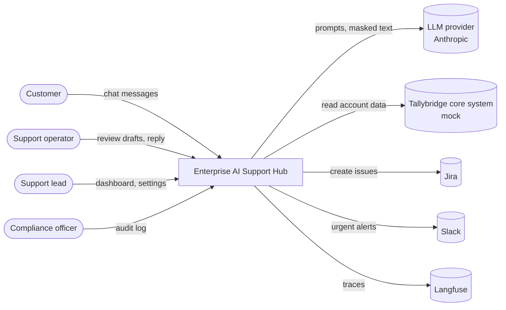
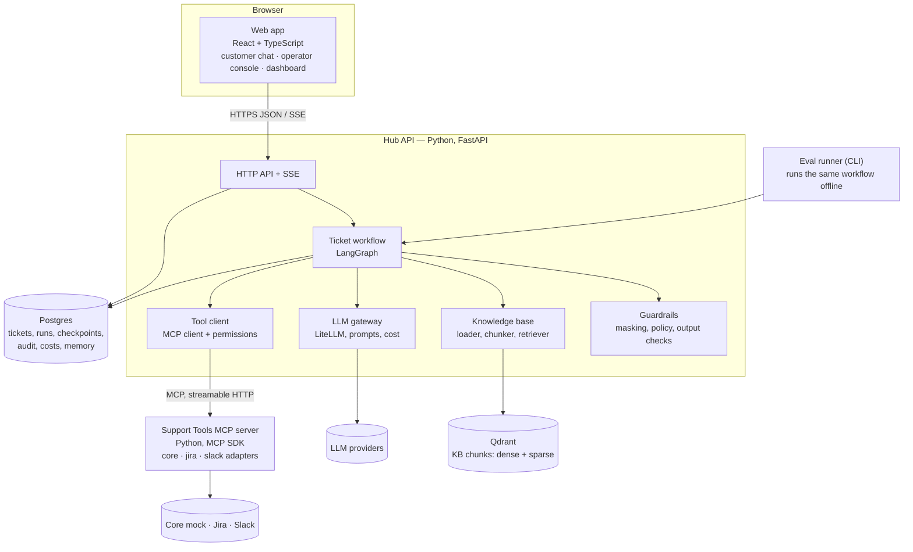
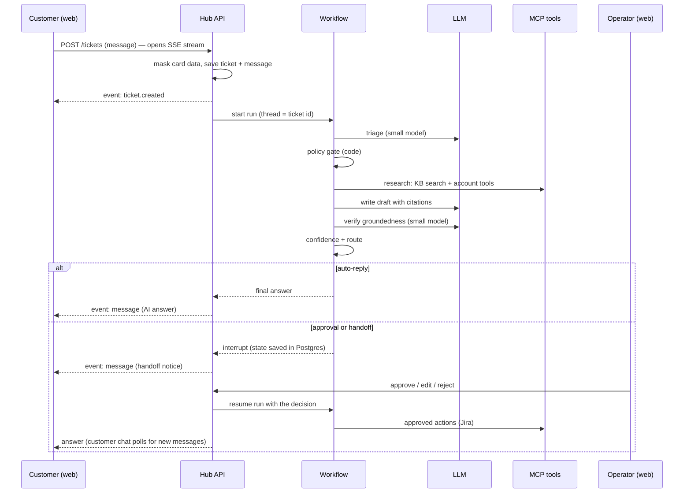

# Design Doc — Enterprise AI Support Hub

Status: approved for build · Read after the [PRD](prd.md). Details live in: [data model](data-model.md), [API](api.md), [AI pipeline](ai-pipeline.md), [eval plan](eval-plan.md), [security](security.md), [operations](operations.md), [UI](ui.md), [ADRs](adr/).

## 1. Summary

The Hub is one backend service (a modular monolith) with a web UI. A customer message becomes a ticket. A LangGraph workflow processes it: mask → classify → apply policy rules → research (knowledge-base search + read-only account tools) → write a cited draft → verify → decide a route. The route is auto-reply, operator approval, or handoff. Paused runs are stored in Postgres and continue when the operator decides. Tools for account data, Jira and Slack live in a separate MCP server. Every model call is recorded for cost and tracing. An offline evaluation package measures quality on labelled tickets.

## 2. Design principles

1. **Justified simplicity.** Every component answers a requirement in the PRD (table in section 5). No requirement — no component.
2. **Workflow first, agent only where needed.** The order of steps is fixed in code. The model chooses freely in one bounded place: which read-only tools to call during research ([ADR-0002](adr/0002-workflow-with-bounded-agentic-step.md)).
3. **Safety rules are code, not prompts.** Masking, always-handoff rules, citation checks and tool permissions are deterministic and unit-tested. A prompt can fail; a rule cannot be talked out of its job.
4. **Evaluation before features.** A change to a prompt, model or retrieval setting is accepted only with an evaluation run.
5. **Fail towards a human.** Any error, timeout, budget stop or doubt ends in handoff, never in a guessed answer.

## 3. Context (C4 level 1)



## 4. Containers (C4 level 2)



| Container | Technology | Responsibility |
|---|---|---|
| Web app | React 19, TypeScript, Vite, TanStack Query, React Router, Tailwind CSS | Customer chat (demo), operator console, lead dashboard, audit view. Built to static files and served by the Hub API. |
| Hub API | Python 3.13, FastAPI, Pydantic v2, SQLAlchemy 2 (async, psycopg 3), Alembic | HTTP API, auth, ticket workflow, guardrails, retrieval, model calls, audit. One deployable unit. |
| Support Tools MCP server | Python, official `mcp` SDK (FastMCP), streamable HTTP + stdio | Tools: account data (mock core), Jira, Slack. Can also be connected to Claude Code. |
| Postgres 16+ | Local: Docker. Demo: Neon free tier | System of record. Also stores LangGraph checkpoints. |
| Qdrant | Local: Docker. Demo: Qdrant Cloud free tier | Hybrid search over knowledge-base chunks. |
| Eval runner | Python package `hub_evals`, CLI | Runs datasets through the workflow, computes metrics, writes reports. |
| Langfuse | Langfuse Cloud free tier (optional locally) | Traces of runs and model calls. |

## 5. Components and the requirements they answer

| Component (module in `hub/`) | Requirements |
|---|---|
| `api/` routers, SSE | FR-1, FR-12, FR-19, NFR-2 |
| `auth/` operator login, roles, demo customer session | FR-12, FR-6, NFR-12 |
| `guardrails/masking` | FR-3, NFR-6 |
| `guardrails/injection`, `guardrails/output_checks` | FR-8, NFR-7, NFR-8 |
| `graph/` workflow, routing, human review | FR-4, FR-8, FR-9, FR-10, FR-11, FR-13, NFR-11 |
| `kb/` loader, chunker, retriever | FR-5, FR-21, FR-24 |
| `llm/` gateway, prompts, pricing, budget | FR-16, NFR-3, NFR-14 |
| `tools/` MCP client, permissions, idempotency | FR-6, FR-14 |
| `memory/` | FR-20 |
| `audit/` | FR-15, NFR-12 |
| `metrics/` | FR-17, FR-18 |
| `privacy/` retention, erasure | FR-22, NFR-13 |
| MCP server | FR-6, FR-14 |
| Eval runner | FR-23, all quality NFRs |
| Web app | FR-2, FR-12, FR-17, FR-18, FR-19 |

## 6. The path of one ticket



Where data lives at each step:

| Step | Data | Store |
|---|---|---|
| Message arrives | text with card data masked and IBANs partly masked (ADR-0017) | `messages.body` (Postgres). The raw text exists only in memory during the request. |
| Model calls | masked text + placeholders for email, phone, IBAN | sent to the provider; metadata in `llm_calls`; trace in Langfuse (masked) |
| Research | chunk ids and scores; tool results | workflow state (checkpoint in Postgres); `tool_calls` |
| Draft | text, citations, proposed actions | `drafts` |
| Decision | route, reasons, confidence, features | `runs`, `tickets`, `audit_log` |
| Final answer | message text | `messages` |

## 7. Key decisions

Each decision has an ADR with alternatives.

| # | Decision | ADR |
|---|---|---|
| 1 | Modular monolith, not microservices | [0001](adr/0001-modular-monolith.md) |
| 2 | Fixed workflow with one bounded agentic step, built with LangGraph | [0002](adr/0002-workflow-with-bounded-agentic-step.md) |
| 3 | LiteLLM as the gateway to several model providers; models chosen by role in config | [0003](adr/0003-litellm-provider-gateway.md) |
| 4 | Structured output with provider JSON schema + Pydantic validation | [0004](adr/0004-structured-output.md) |
| 5 | Qdrant with hybrid search (dense + BM25, RRF fusion) | [0005](adr/0005-qdrant-hybrid-search.md) |
| 6 | Chunk knowledge-base articles by section | [0006](adr/0006-section-chunking.md) |
| 7 | Process a ticket inside the HTTP request and stream progress with SSE; no queue | [0007](adr/0007-in-request-processing-sse.md) |
| 8 | Human-in-the-loop with LangGraph `interrupt` and a Postgres checkpointer | [0008](adr/0008-hitl-interrupt-checkpointer.md) |
| 9 | Routing = policy rules first, then a confidence score (in budget mode the rule score, ADR-0018); never the model's own "I am sure" | [0009](adr/0009-confidence-and-routing.md) |
| 10 | Mask card data before storage and before any model call | [0010](adr/0010-masking-before-everything.md) |
| 11 | All external tools behind one MCP server; customer identity injected by the Hub | [0011](adr/0011-mcp-tools-and-identity-binding.md) |
| 12 | Customer memory = ticket summaries in Postgres | [0012](adr/0012-customer-memory.md) |
| 13 | Prompts are versioned files in the repository | [0013](adr/0013-prompts-as-files.md) |
| 14 | Tracing with Langfuse plus an own `llm_calls` table | [0014](adr/0014-observability.md) |
| 15 | Free-tier deployment: Cloud Run + Neon + Qdrant Cloud | [0015](adr/0015-free-tier-deployment.md) |
| 16 | React console served by the API; cookie sessions | [0016](adr/0016-web-ui-and-auth.md) |
| 18 | Budget mode: Anthropic only, Haiku for every role, local embeddings, a small evaluation (replaces parts of 0003, 0005, 0009, 0013) | [0018](adr/0018-budget-mode.md) |

## 8. Repository layout

```
.
├── AGENTS.md  CLAUDE.md  README.md  Makefile  pyproject.toml  uv.lock
├── apps/
│   ├── api/                     # package `hub`
│   │   ├── src/hub/
│   │   │   ├── main.py  config.py  deps.py
│   │   │   ├── api/             # routers: tickets, console, auth, admin, metrics, health
│   │   │   ├── auth/
│   │   │   ├── db/              # SQLAlchemy models, session, repositories
│   │   │   ├── domain/          # enums and Pydantic models shared by all modules
│   │   │   ├── guardrails/      # masking.py, placeholders.py, injection.py, output_checks.py, policy.py
│   │   │   ├── kb/              # loader.py, chunker.py, index.py, retriever.py
│   │   │   ├── llm/             # gateway.py, structured.py, prompts.py, pricing.py, budget.py, schemas.py
│   │   │   ├── graph/           # state.py, build.py, nodes/, routing.py, confidence.py
│   │   │   ├── tools/           # mcp_client.py, registry.py, permissions.py
│   │   │   ├── memory/  audit/  metrics/  privacy/  observability/
│   │   └── tests/               # unit/, integration/ (testcontainers), e2e/
│   ├── mcp_server/              # package `support_tools`
│   │   ├── src/support_tools/   # server.py, adapters/{core,jira,slack}.py
│   │   └── tests/
│   └── web/                     # React app
├── evals/                       # package `hub_evals`: runner, metrics, judges, reports
│   └── runs/                    # committed reports (small files only)
├── prompts/                     # <node>/v1.md ...
├── config/                      # models.yaml, pricing.yaml, policy.yaml, confidence.json
├── data/
│   ├── kb/                      # articles *.md + error_codes.csv
│   ├── seed/                    # customers.json, transactions.json, cards.json, operators.json
│   └── eval/                    # tickets.dev.jsonl, attacks.jsonl (no test set, ADR-0018)
├── experiments/                 # small scripts, for example the E9 threshold counts (ADR-0018)
├── infra/                       # docker-compose.yml, Dockerfile.api, Dockerfile.mcp, alembic/, cloudrun/
├── docs/                        # this package
└── .github/                     # workflows/, ISSUE_TEMPLATE/
```

Module rules (enforced by import-linter in CI):
- `domain` imports nothing from the project.
- `guardrails`, `kb`, `llm`, `tools`, `memory`, `audit`, `privacy`, `metrics` do not import `api` or `graph`.
- Only `llm/gateway.py` imports `litellm`; everything else reaches models through the gateway.
- `graph` is the only module that combines the others. `api` calls `graph` and repositories.
- `apps/mcp_server` and `apps/api` do not import each other. They talk only over MCP.
- `evals` imports `hub.graph` and runs the same code as production.
- `evals` and `apps/mcp_server` do not import each other. Evaluation reaches the tools the way production does: through `hub.graph` and MCP.

## 9. Technology choices

| Area | Choice | Note |
|---|---|---|
| Language | Python 3.13, uv workspace | One lock file. |
| API | FastAPI, Uvicorn | Async. |
| Data | SQLAlchemy 2 async + psycopg 3, Alembic | One driver for the app and for the LangGraph checkpointer. |
| Workflow | LangGraph + `langgraph-checkpoint-postgres` | No LangChain chat-model wrappers; nodes call the own gateway. |
| Models | LiteLLM SDK (library, not the proxy server) | Roles → models in `config/models.yaml`. |
| Search | Qdrant, `qdrant-client`, FastEmbed (BM25 sparse vectors and the local dense model `BAAI/bge-small-en-v1.5`) | Dense embeddings run locally through the gateway, never through an API (ADR-0018). |
| Tools | `mcp` Python SDK | Server and client. |
| Tracing | Langfuse (OpenTelemetry) | Optional in local development. |
| Quality | pytest, pytest-asyncio, testcontainers, ruff, mypy (strict), import-linter | |
| Web | React 19, TypeScript, Vite, TanStack Query, Tailwind, Vitest, Playwright | |
| CI/CD | GitHub Actions | Lint, types, tests, eval smoke, build, deploy. |

**Version rule for the builder:** this document names libraries, not versions. Before adding a dependency, read its current documentation and release notes, pin the version in `uv.lock`, and do not use any API from memory without checking it. LiteLLM had a compromised PyPI release in 2026 — check the security advisories and pin a safe version.

## 10. Failure handling

| Failure | Behaviour |
|---|---|
| Model call fails or times out (30 s per call) | 2 retries with backoff, then the fallback model of the role, then handoff with reason `system_error`. |
| Structured output does not match the schema | One repair retry with the validation error, then handoff. |
| Qdrant or MCP server not reachable | Research continues without that source; route cannot be auto-reply; reason `degraded`. |
| Daily budget reached | New runs skip all model calls and hand off with reason `budget_exceeded`. |
| Client disconnects during a run | The run is a task of its own and goes on. State is checkpointed after every node. A run stuck in `running` (its process stopped) is resumed on the next read of the ticket or by `POST /admin/runs/recover`, once it started longer ago than any run can take (the sum of the node timeouts plus 60 s, about 10 minutes; owner decision P6-03, was 90 s: a slow run on the other instance must not run twice). A paused run whose resume was lost after the operator's decision is resumed by the hourly `recover-runs` job (P8-05). |
| Operator approves a stale draft (customer wrote again) | The API returns 409; the console reloads the ticket. |
| Duplicate request (retry from the browser) | `Idempotency-Key` header on message and action endpoints. |

## 11. Threat model (short)

Full version: [security.md](security.md).

| Threat | Main control |
|---|---|
| Card number reaches the provider, the logs or the database | Masking before storage; second scan before every model call; output scan. |
| Prompt injection in a ticket | Input treated as data; fixed policy rules; read-only tools; identity binding; attack suite in CI. |
| Customer reads another customer's data through the AI | Tools never take the customer id from the model. |
| Internal procedure or compliance reason leaks | Only `external` chunks reach the writer; output check; tipping-off rule in policy. |
| Endless loop or runaway cost | Step limits, one retry, timeouts, daily budget. |
| Operator misuse | Roles, audit log with hash chain. |

## 12. Open questions

These do not block the build. Each has a default. ADR-0018 removed the experiments, so most stay open; the README lists them.

| Question | Default now | Answered in |
|---|---|---|
| Does RAG beat "whole knowledge base in the prompt" on quality, or only on cost and latency? | Build both; RAG is the default. | Not measured (E1 removed) |
| Is a reranker worth the extra latency? | Off; not built. | Not measured (E3 removed) |
| Which node can use the small model without a quality loss? | Small model (Haiku) for every role. | Not measured (E8 removed) |
| How much does the retry loop help? | One retry on. | Not measured (E7 removed) |
| Where is the confidence threshold? | Rule score, auto-reply off by default; no trained model (ADR-0018). Auto-reply stays off in the demo (ADR-0019). | — |
| Does a fine-tuned small classifier match the LLM on triage? | LLM triage. | Not measured (phase 11 removed) |
