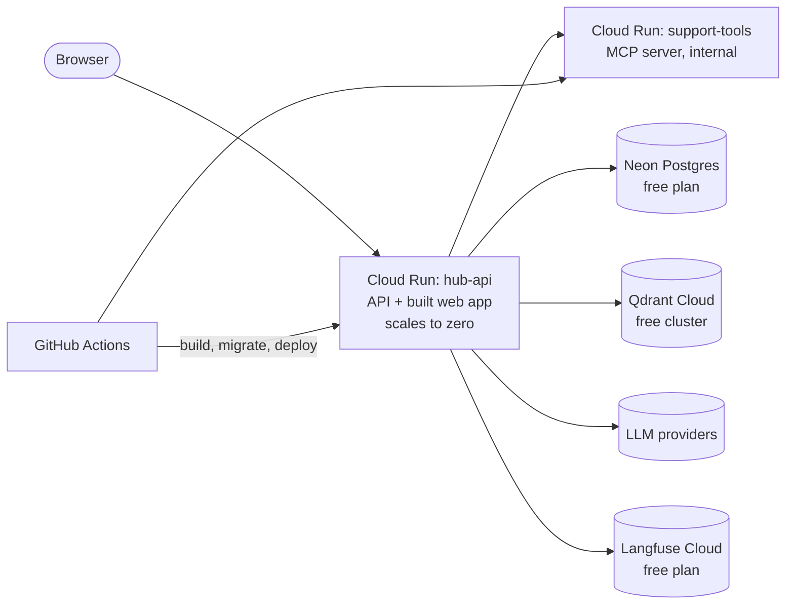

# Operations: local setup, configuration, observability, CI/CD, deployment

## 1. Local development

Requirements: Docker, Python 3.13 with `uv`, Node.js LTS with `pnpm`, `make`.

`infra/docker-compose.yml` services: `postgres`, `qdrant`, `api` (hot reload), `mcp` (support-tools server). The web app's Vite dev server runs on the host, not in compose (P10-01): `pnpm -C apps/web dev` serves `http://localhost:5173` and forwards `/api`, `/health` and `/ready` to the API (`API_URL`, default `http://127.0.0.1:8000`), so the cookies stay first-party as in production, where the API serves the built app (ADR-0016). Optional profile `tracing`: self-hosted Langfuse — only if the cloud free tier is not used.

Build state: the services arrive with their phases. Phase 2 has `postgres`, `qdrant` and `api`; `mcp` (the support-tools MCP server, `infra/Dockerfile.mcp`) came in P7-01. `GET /ready` reports `postgres`, `qdrant` and `mcp`; the compose healthcheck of `api` uses `/health`, so the api stays healthy while a dependency is down. The `mcp` service mounts `data/seed` read-only and keeps the Jira and Slack mock calls in a SQLite file in the container's `/tmp` (lost when the container is removed). Likewise `make dev` gains `migrate`, `seed` and `kb-load` as P2-02, P2-05 and P2-09 build them. **`make dev` needs `SEED_OPERATOR_PASSWORD`, `SESSION_SECRET`, `DEMO_ACCESS_CODE` and `MCP_SERVER_TOKEN` in `.env`:** `.env.example` leaves them empty on purpose (no shared demo secrets in the repository). The first step of `make dev` (`hub/dev_check.py`) lists every one that is empty in a single message and stops before anything is started or written; set them in `.env` and run `make dev` again. `make seed` on its own still checks `SEED_OPERATOR_PASSWORD` and writes nothing when it is empty. Ports bind to `127.0.0.1` only. Integration tests do not use this stack: testcontainers starts Postgres and Qdrant with the image tags of the compose file.

| Command | Does |
|---|---|
| `make setup` | `uv sync`, `pnpm -C apps/web install --frozen-lockfile` (pnpm 12.18.0, the `packageManager` of `apps/web/package.json`; Node 24 LTS or newer), copy `.env.example` → `.env` if missing, install pre-commit hooks, `make models` |
| `make models` | download the local embedding model and the BM25 files into `EMBEDDING_CACHE_DIR` (needs the network once) and check the model file against its pinned SHA-256 (`hub/llm/local_embedding.py`) |
| `make up` / `make down` | start / stop the compose stack |
| `make migrate` | Alembic upgrade of the app database, then of the evaluation database (`-x db=eval`, migrator `EVAL_DATABASE_URL_DIRECT`; skipped when `EVAL_DATABASE_URL` is empty, refused when it names the app database; P4-03) , including the LangGraph checkpoint tables (migration 0009, P6-01) |
| `make seed` | load demo customers, operators, settings (idempotent: customers are upserted by `external_ref`, except anonymised ones; operators and settings are inserted only when missing) |
| `make kb-load` | load `data/kb` into Postgres (only changed documents), then sync the Qdrant index with Postgres: only chunks whose text changed are embedded again (`hub/kb/service.py`, P5-01). `FULL=1` also re-chunks unchanged files (writes only those whose chunks differ), builds a new collection and moves the alias `kb_chunks` to it |
| `make dev` | `models` + `up` + `migrate` + `seed` + `kb-load` |
| `make mcp` | run the support-tools MCP server over stdio (what Claude Code starts; see the README) |
| `make mcp-smoke` | start the MCP server over streamable HTTP (random bearer token) and over stdio, list the tools and call `core_get_transaction` on each with the official MCP client; also checks that a request without the token gets 401 |
| `make test` | unit tests (no network, no containers), then the web app's Vitest tests when `apps/web/node_modules` exists |
| `make test-int` | integration tests with testcontainers (Postgres, Qdrant) and recorded model responses |
| `make test-e2e` | Playwright against the e2e compose stack (`infra/compose.e2e.yml`, project `support-hub-e2e`, port 8100): builds the web app, starts the dev images with fixed test settings and fake models, runs migrations, seed and KB load in the api container, runs the UI §6 scenarios with axe checks, then removes the stack (`KEEP=1` keeps it). The api runs without account tools there, because the recorded answers were made without them |
| `make load-smoke` | P10-08: 10 parallel customers, 50 tickets against a running stack with fake models (default the e2e stack, `URL=` for another); prints p50/p95 latency, the error rate and lost runs (`infra/load/smoke.py`). Uses 50 of the 60 messages per hour per IP |
| `make lint` | ruff, mypy, import-linter, eslint, tsc |
| `make data-check` | validate `data/` (seed schemas and rules; KB front matter, `error_codes.csv`, internal-only phrases in external content; seed error codes must be in the CSV; evaluation tickets and attacks: schema per line, known customers and external gold documents, composition rules of the [eval plan](eval-plan.md) §3) |
| `make kb-numbers` | report every number in `data/kb/` that is not in the world file (a report, not a gate) |
| `make eval`, `make eval-smoke`, `make eval-attacks` | see [eval plan](eval-plan.md); real model calls, run by hand only when the owner asks (ADR-0018). `LLM_MODE=fake make eval LIMIT=10` checks the runner for free (the eval tickets have no recordings, so each is handed off with `system_error`, and judges have no recordings either; `NO_JUDGES=1` skips them) |
| `make web-types` | generate the web app's TypeScript types (`apps/web/src/api/schema.d.ts`, committed) from the OpenAPI document of the app object (`hub/openapi.py`: no server, database or `.env`); CI fails when the committed file is out of date |
| `make retention` | run the retention job once through the running local API (`POST /admin/jobs/retention` with `JOBS_TOKEN` from `.env`; `API_URL` overrides `http://localhost:8000`) |
| `make record-llm` | refresh recorded model responses for tests (real calls): the app's in `apps/api/tests/fixtures/llm/` (`hub.llm.record`), then the judges' in `evals/tests/fixtures/llm/` (`hub_evals.record`); skips models that already have a real recording, `FORCE=1` records them again |
| `make llm-requests` | rewrite the recording requests (no model call): triage from the example tickets, the run tickets (`tests/fixtures/run/tickets.jsonl`) for triage and write: their search hits are found again with the real local models in Qdrant's in-memory mode (needs `make models`) and kept in `tests/fixtures/run/evidence.json`, and the write request is built from those chunks (an integration test checks the real server finds the same hits), and the judge test cases (`evals/tests/fixtures/judges/cases.jsonl`); run before `make record-llm` after a prompt or KB change (a KB change changes every write request) |
| `make eval-report RUN=<id> BASE=<id>` | compare two evaluation runs; see [eval plan](eval-plan.md) |
| `make leak-scan` | scan database, logs and recorded model requests for card patterns and canary strings |
| `make export-review-candidates` | export rejected and heavily edited drafts as candidates for new eval tickets |
| `make rollback` | send traffic back to the previous deployed revision |

**Fake model provider.** `LLM_MODE=fake` makes the gateway return deterministic recorded or scripted responses for chat calls. Embeddings always come from the local model, in both modes (free, offline, deterministic; P5-01). Unit, integration and e2e tests run with it, so tests need no API key and cost nothing. Recordings live in `apps/api/tests/fixtures/llm/` and are refreshed with `make record-llm` (real calls). The compose `api` service mounts them read-only where the gateway looks (`FIXTURES_DIR`), with `config/` and `prompts/` (the app loads both at start), so `make dev` runs in fake mode; a ticket whose text has no recording is handed to a human (`system_error`). Only the run tickets have recordings; use `LLM_MODE=real` for other texts.

## 2. Configuration

All settings are environment variables read by one Pydantic `Settings` class (`hub/config.py`). `.env.example` lists every variable with a comment. No setting is read anywhere else in the Hub. The MCP server is a separate app and reads its own few variables from the environment (`support_tools/server.py`, `ServerSettings`): `MCP_SERVER_TOKEN` and `CORE_ANCHOR_DATE` (the same values as the Hub's), `MCP_MOCK_DB` (SQLite file of the Jira and Slack mocks; default `.cache/mcp-mock.sqlite`, `/tmp/mcp-mock.sqlite` in the image) and `SEED_DIR` (default `data/seed`). The last two are not in `.env.example`: the Hub refuses unknown variables in `.env`.

| Variable | Example | Note |
|---|---|---|
| `APP_ENV` | `local` \| `test` \| `demo` | |
| `DATABASE_URL` | `postgresql+psycopg://…` | pooled connection as the **app role** (a login user in group `hub_app`) |
| `DATABASE_URL_DIRECT` | | direct (not pooled) connection as the **migrator** (schema owner) for migrations and checkpointer setup; empty = same as `DATABASE_URL`, which only works when that user may create tables |
| `EVAL_DATABASE_URL` | | separate database for evaluation runs, as the app role |
| `EVAL_DATABASE_URL_DIRECT` | | migrator of the evaluation database (`make migrate`); empty = `DATABASE_URL_DIRECT` (or `DATABASE_URL`) with the database name of `EVAL_DATABASE_URL` |
| `CORE_ANCHOR_DATE` | empty \| `2026-11-12` | "today" for the core mock and the workflow; empty = real date; fixed in tests and evaluation |
| `JOBS_TOKEN` | random | bearer token for `POST /admin/jobs/*`; empty turns the jobs off (`503`) |
| `RETENTION_TICKET_DAYS` | `730` | retention job: delete tickets after this many days without activity (security §6) |
| `RETENTION_CHECKPOINT_DAYS` | `7` | retention job: delete a closed ticket's checkpoints this many days after the close |
| `QDRANT_URL`, `QDRANT_API_KEY` | | key empty locally |
| `EMBEDDING_CACHE_DIR` | `.cache/models` | folder of the local embedding model (`BAAI/bge-small-en-v1.5`) and the BM25 files; `make models` downloads them, the app only reads them (`local_files_only`, ADR-0018). The compose `api` service mounts it read-only |
| `ANTHROPIC_API_KEY` | | read by LiteLLM; the only provider key (ADR-0018) |
| `LLM_MODE` | `real` \| `fake` | |
| `MODELS_CONFIG` | `config/models.yaml` | |
| `PROMPTS_DIR` | `prompts` | prompt files; the active versions are in `MODELS_CONFIG` |
| `POLICY_CONFIG` | `config/policy.yaml` | routing rules, notice texts, support hours ([AI pipeline](ai-pipeline.md) §6); a broken file stops the start |
| `CONFIDENCE_CONFIG` | `config/confidence.json` | rule version of confidence (AI pipeline §6) |
| `MCP_SERVER_URL`, `MCP_SERVER_TOKEN` | `http://mcp:8001/mcp` | the token is required: the server's HTTP transport refuses to start without one, and refuses every request without it (401) |
| `JIRA_MODE`, `SLACK_MODE` | `mock` | only `mock` ([ADR-0019](adr/0019-scope-cuts.md)); the real-mode settings were removed in P7-02, and an old `.env` line such as `JIRA_API_TOKEN=` now stops the start (unknown variable) |
| `SESSION_SECRET` | random 32 bytes | |
| `DEMO_ACCESS_CODE` | | for the public chat |
| `DEMO_CUSTOMERS_FILE` | `data/seed/demo_customers.json` | the chat's customer picker (`GET /demo/customers`, P10-02); compose mounts it read-only, the API image copies it (P10-06) |
| `SEED_OPERATOR_PASSWORD` | | used by `make seed` |
| `LANGFUSE_PUBLIC_KEY`, `LANGFUSE_SECRET_KEY`, `LANGFUSE_HOST` | | tracing is off when empty |
| `DAILY_BUDGET_USD` | `0.20` | start value of the setting (the production guard, §6) |
| `AUTO_REPLY_ALLOWED` | `false` | deployment lock on auto-reply ([ADR-0019](adr/0019-scope-cuts.md), [security](security.md) §3 G5): while false a lead cannot switch auto-reply on and the graph sends every draft to an operator |
| `EVAL_MAX_COST_USD` | `1.00` | hard stop for one evaluation run |
| `EVAL_TRACE_SAMPLE` | `0.2` | share of evaluation runs sent to Langfuse |
| `EVAL_RUNS_DIR` | `evals/runs` | committed evaluation runs; `GET /console/evals/latest` reads the newest clean real-model run here (the API image must contain the folder, P10-06) |
| `LOG_LEVEL` | `INFO` | |

**Database roles** (security §4, least privilege). Two connections, two roles:
- **Migrator**: owns the schema and runs `make migrate` through `DATABASE_URL_DIRECT`. Locally `hub`; on Neon the owner role of the database.
- **App**: the API connects through `DATABASE_URL` as a login user that is a member of the group role `hub_app`. Locally `hub_api` (created by `infra/postgres/init/02-app-user.sql`). Migration 0001 creates `hub_app` when it is missing and gives it, through default privileges, read and write access to every table the migrator creates; `audit_log` keeps only `SELECT` and `INSERT`.
- **Deploy setup (once per managed database, before the first deploy):** as the owner role, `CREATE ROLE hub_app NOLOGIN;` (or let migration 0001 do it) and `CREATE ROLE <app user> LOGIN PASSWORD '<secret>' IN ROLE hub_app;`. The password goes into the secret for `DATABASE_URL`, never into the repository.

Runtime settings that the lead changes in the console (auto-reply, threshold, budget, allow-list) live in the `settings` table; environment variables give only the first values.

## 3. Observability

**Three layers, each with one job.**

| Layer | Tool | Answers the question |
|---|---|---|
| Structured logs | `structlog`, JSON to stdout, masked | What happened in the service? Each line has `ticket_id`, `run_id`, `node`, `request_id`. |
| Traces | Langfuse via OpenTelemetry | What did this run do, step by step? One trace per run; one span per node; one generation per model call (masked input and output, tokens, cost, prompt version); spans for retrieval (query, chunk ids, scores) and tool calls. Trace id stored in `runs.trace_id`; the console links to it. |
| Business and cost data | Postgres: `runs`, `llm_calls`, `drafts`, `feedback` | How is the service doing? Source for the dashboard and for cost. Does not depend on the tracing vendor. |

Trace attributes on every run: `ticket_id`, `intent`, `route`, `route_reasons`, `confidence`, `graph_version`, `prompt_versions`, `variant`, `context` (`online` / `eval`). Eval runs are traced with the tag `eval` and the run id, so a bad eval ticket can be opened as a trace.

**Dashboard numbers** (from Postgres, see [API](api.md) §5): tickets by route, automation share, route reasons, draft outcomes and edit ratio, latency p50/p95, cost per ticket and by node, feedback, budget used, last eval summary with pass/fail against the red lines.

**Alerts** are not built: they were part of phase 9, removed by [ADR-0019](adr/0019-scope-cuts.md). The design, kept for reference: a daily summary and these conditions logged and posted to the Slack mock: budget above 80%; error rate of runs above 10% in an hour; p95 latency above the red line in an hour; audit chain check failed.

**Runbook** (`docs/runbook.md`): not written, phase 9 was removed (ADR-0019). Its planned content: what to do when — auto-replies are wrong (switch off, find the traces, add eval tickets); the provider is down (fallback model, handoff mode); the budget is reached; a run is stuck; a card number is found in storage (incident steps).

## 4. Cost control

- Costs are recorded in USD, the currency of the provider price lists. Targets in the PRD are in EUR; reports convert with one fixed rate from `config/pricing.yaml` and print the rate.
- Prices per model in `config/pricing.yaml` (input, output, cached input; date of the price). The gateway computes `cost_usd` for every call.
- Prompt caching for the stable system part of every prompt (provider feature; the builder checks the current rules and minimum sizes).
- One small model for every role: Claude Haiku 5.5, fallback Claude Sonnet 5.5 ([ADR-0018](adr/0018-budget-mode.md)). Embeddings run locally (FastEmbed, `BAAI/bge-small-en-v1.5`) and cost nothing.
- Project budget: about $5 of model calls in total. The owner sets a $5 spending limit in the Anthropic console. Paid evaluation runs only by hand, when the owner asks; none in CI.
- Limits: input 4,000 characters, 10 history turns, 8 chunks, `max_tokens` per role.
- Daily budget guard (G8). Evaluation has its own limit (`EVAL_MAX_COST_USD`) and a disk cache that is on by default.

## 5. CI (GitHub Actions)

| Workflow | Trigger | Jobs |
|---|---|---|
| `ci.yml` | pull request, push to main | `lint` (ruff, mypy, import-linter, eslint, tsc; installs Node and the web dependencies) · `test` (unit tests, coverage gate for safety modules) · `test-int` (integration with testcontainers; builds the api dev image) · `web` (`make web-types` must leave `schema.d.ts` unchanged, Vitest, production build) · `e2e` (`make test-e2e`: compose + Playwright + axe, fake models; the report is uploaded on failure) · `security` (gitleaks over the whole history, pip-audit over the locked and hashed requirements, pnpm audit at level `high`) · `data-check` · `hook-bootstrap` (informational, not required: the gitleaks pre-commit hook installs on a machine without Go) |
| `deploy.yml` | push to main after `ci` is green; manual | build images → push → migrate → deploy → smoke check |

**Dependency updates (P8-06, security T11).** Dependabot (`.github/dependabot.yml`) checks weekly for the uv workspace (`uv.lock`), GitHub Actions, the web app (`npm`, which covers pnpm) and the dev images' base images (`infra/`), with a 7-day cooldown on version updates (security updates come at once). Each update is a normal pull request. Patch and minor updates are auto-merged (`.github/workflows/dependabot-automerge.yml`, `gh pr merge --auto --squash`) once the checks the `main` ruleset requires are green (lint, test, test-int, data-check, security); majors wait for the owner. Frozen, because they change model or retrieval behaviour: `litellm`, `langchain*`, `langgraph*`, `fastembed`, `onnxruntime`, `qdrant-client` are ignored by Dependabot and never auto-merged; updating one is a task with an eval run. The gitleaks pre-commit hook builds with a pinned Go (`language_version` in `.pre-commit-config.yaml`, at least the `go` line of gitleaks' `go.mod`); pre-commit downloads exactly that toolchain, also on machines that have Go, and updates it only when someone changes the pin.

No workflow runs an evaluation or any other real model call, except the post-deploy canary ticket (§6, under one cent). `make eval-smoke` runs by hand, only when the owner asks ([ADR-0018](adr/0018-budget-mode.md)).

Branch rule: changes reach `main` only through pull requests, and CI must be green. Until phase 12 the repository is private on the free GitHub plan, which has no branch protection, so the rule holds by process (only the owner merges). The owner turns branch protection on when the repository becomes public; the README section "CI and branch protection" lists the settings.

## 6. Deployment (demo, free tier)

Decision and alternatives: [ADR-0015](adr/0015-free-tier-deployment.md).

| Part | Service | Cost | Note |
|---|---|---|---|
| API + web | Google Cloud Run, 1 service, min instances 0, max 2, 1 vCPU / 1 GiB, request-based billing | inside the always-free allowance for demo traffic | Needs a billing account with a card. A budget alert at €1 is set. Cold start a few seconds — acceptable for a demo; the README says so. |
| MCP server | Cloud Run, second service, min 0 | free | "Require authentication" is on: only the service account of `hub-api` has the invoker role. The bearer token is a second check. |
| Postgres | Neon free plan | free | Checked 2026-11: 100 compute-hours per month, about 1 GB storage, the database sleeps after 5 minutes without queries (first query after that is slow). Pooled connection string for the app — the builder checks that psycopg prepared statements and the LangGraph checkpointer work through the pooler; direct connection for migrations. |
| Vector search | Qdrant Cloud free cluster (1 GB RAM) | free | Checked 2026-11: a free cluster is suspended after 1 week without use and deleted after 4 weeks. A scheduled GitHub Action calls the `ping` job every 3 days. If the cluster is lost, `make kb-load` rebuilds it in minutes. |
| Tracing | Langfuse Cloud free plan | free | Checked 2026-11: 50,000 units per month, 30 days of data. Full evaluation runs can use this up — tracing of eval runs is sampled (`EVAL_TRACE_SAMPLE`, default 0.2). |
| Images | Artifact Registry or GitHub Container Registry | free at this size | |
| Model calls | Anthropic API (the only provider, ADR-0018) | pay per use | The only real cost. About $5 for the whole project. **Production daily budget guard: $0.20** (owner decision, 2026-11-23): `DAILY_BUDGET_USD` defaults to 0.20 in the code and in `.env.example` (owner decision, P10-02), and the seeded `daily_budget_usd` setting starts at that value; a lead may lower it in the console. Embeddings run inside the API container (the image contains the model). |

Free tiers change. **Before phase 10 the builder checks the current limits on the official pricing pages and updates this table.** Everything runs in standard containers with standard Postgres and Qdrant, so the fallback is simple: one small VPS with the same `docker-compose.yml` plus Caddy for HTTPS (`infra/compose.prod.yml` is kept working for this).

Deployment rules:
- Images: multi-stage builds, non-root user, only runtime dependencies (P10-06). `infra/Dockerfile.api` and `infra/Dockerfile.mcp` have a `dev` target (compose, source mounted, reload) and a `prod` target (default). The API's `prod` image builds the web app (Node 24, pnpm from `packageManager`) and serves it (`WEB_DIST_DIR`; `hub/api/web.py`: `/assets` cached, every other non-API page answers `index.html`), contains the local embedding model downloaded and checked at build time (no network needed for embeddings), the config, prompts, KB, seed and the committed evaluation summaries, and starts uvicorn with `--proxy-headers` trusting `FORWARDED_ALLOW_IPS`. It sets `APP_ENV=demo` and `LLM_MODE=real`; it has no test fixtures.
- VPS fallback: `docker compose --env-file .env -f infra/compose.prod.yml up --build` (from the repo root) runs Postgres, Qdrant, the MCP server, a one-shot `setup` (migrations, seed, KB load) and the API behind Caddy (`infra/Caddyfile`). `--env-file` is required: compose fills the `${...}` values in the file (database password, budget, ports) only from the shell or that file, not from `env_file:`. Only Caddy publishes ports: `HTTP_PORT` (default 8080) and `HTTPS_PORT` (default 8443). Without `SITE_ADDRESS` it serves plain HTTP on `HTTP_PORT` (local check). For a real domain set `SITE_ADDRESS` to the domain, `HTTP_PORT=80` and `HTTPS_PORT=443`, and point DNS at the host; Caddy needs both ports to get the certificate and redirect HTTP to HTTPS. `DAILY_BUDGET_USD` defaults to 0.20 there. The app role `hub_api` keeps the init script's password until P10-07 sets it from a secret.
- Secrets in Google Secret Manager (or Cloud Run secrets), never in the image or the repository.
- Migrations run as a separate step before the new revision gets traffic. Migrations must be backward compatible with the running version.
- After deploy: smoke check — `/ready`, then one fixed canary ticket through the real pipeline (cost under one cent). A failed check triggers the rollback.
- Rollback: previous Cloud Run revision gets the traffic again (`make rollback`).
- Because Cloud Run gives CPU only during a request, all work happens inside requests ([ADR-0007](adr/0007-in-request-processing-sse.md)). Scheduled work is triggered by GitHub Actions schedules that call `POST /admin/jobs/{name}` with `JOBS_TOKEN`: `close-stale` and `recover-runs` every hour, `retention` every night, `ping` every 3 days. No evaluation runs in GitHub Actions (ADR-0018).

## 7. Backups

Demo data is synthetic and can be rebuilt with `make migrate seed kb-load`, so there is no backup duty. The README states what a real system would add: point-in-time recovery for Postgres, Qdrant snapshots, restore drills.
